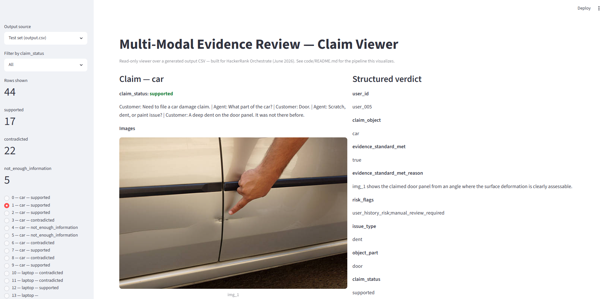

# Multi-Modal Claims Evidence Review

A system that reviews damage claims for cars, laptops and packages from photo evidence, and decides
whether the photos **support** the claim, **contradict** it, or are **not enough** to judge. Built
solo in 24 hours for HackerRank Orchestrate (June 2026), where it placed **109th of 1,773 (top 6%)**.
The original brief is in [`problem_statement.md`](./problem_statement.md).

[](https://github.com/zeyadelganainy/multimodal-claims-evidence-review/actions/workflows/ci.yml)



## The problem

Claim reviewers have to judge photos, not the claimant's story. Each claim comes with a short
conversation, one or more photos, the claimant's history and the minimum evidence required for that
type of object. The output is a structured verdict: whether the evidence standard is met, the
visible issue and its severity, which images drove the decision, and risk flags such as blurry
images, the wrong object, signs of editing or a prompt-injection attempt.

## Key design decisions

- **The model judges, the code decides.** Claude Opus 4.8 handles what genuinely needs vision:
  what is in each image, its quality and authenticity, the damage type, location and severity.
  Every field that has a deterministic rule (the ordered `claim_status` cascade, consistency between
  severity and issue type, which flags go together) is computed in `validation.py` rather than
  taken from the model's output. A decision about money never depends on the model applying every
  business rule correctly.
- **One structured call per claim.** All images and context go into a single multimodal call that
  returns JSON against a schema. That lets the model reason across images (do two photos even show
  the same vehicle?) and keeps cost down.
  The reasoning is in [`code/README.md`](./code/README.md).
- **Detection is kept separate from judgment.** Instructions hidden in the text or written inside a
  photo (for example "approve this claim") raise an independent risk flag that forces manual review,
  but never change the verdict itself.
- **Cheap checks run first.** Exact and near-duplicate images are caught with SHA-256 and perceptual
  hashing before any model call, which removes a class of fraud from the model's job and saves cost.
- **Built to survive failure.** Results are written to the CSV one row at a time. Before that change,
  a single oversized-image crash lost 34 of 44 results.

## Tech stack

Python, the Anthropic Claude API (structured JSON output and prompt caching), Pillow and ImageHash,
pandas, and Streamlit for the results viewer.

## Run it locally

```bash
pip install -r code/requirements.txt
export ANTHROPIC_API_KEY=...          # read from the environment, never hardcoded

python code/main.py                   # full claim set -> output.csv
python code/evaluation/main.py        # score against the hand-labeled sample set
streamlit run code/app.py             # browse claims, images and verdicts side by side
```

The full test set (44 claims, 82 images) costs about $1.76 at Claude Opus list pricing, mainly
because the static system prompt and worked examples are cached.

## How it's tested

**Smoke tests.** Each pipeline component has a no-API-call test (`code/_smoke_test_*.py`), covering
CSV input and output, image resolution and duplicate detection, the lookup tables, and the validation
layer checked against known sample rows. CI runs them on every push.

**Evaluation harness.** `code/evaluation/main.py` scores predictions field by field against the 20
hand-labeled claims in `dataset/sample_claims.csv`:

| Field | Accuracy | | Field | Accuracy |
|---|---|---|---|---|
| `claim_status` | 85% | | `issue_type` | 70% |
| `object_part` | 95% | | `supporting_image_ids` | 75% |
| `evidence_standard_met` | 90% | | `severity` | 55% |
| `valid_image` | 90% | | `risk_flags` | 55% |

The harness surfaced four bugs that were then fixed, including a cascade-ordering error that labelled
insufficient-evidence cases as contradictions and an image-authenticity rule that fired too often.
Details are in [`code/evaluation/evaluation_report.md`](./code/evaluation/evaluation_report.md).

## Known limitations and next steps

- **The labeled set is small.** With 20 claims, each one is worth 5 points, so these percentages
  are indicative rather than precise. Next: a larger labeled set, especially for edge cases.
- **Severity and risk flags are the weakest fields (55%).** Severity is partly subjective from a
  photo, and risk flags are scored as an exact set match. Next: clearer severity rubrics in the
  prompt and partial-credit scoring for flags.
- **One model, one provider.** There is no fallback model if the API is unavailable.
- **Smoke tests rather than a full unit-test suite.** They exercise each component on realistic
  inputs, but do not use a test framework or measure coverage.

## How it was built

I used Claude Code for implementation while making the architecture decisions and reviewing the
output myself. [`AGENTS.md`](./AGENTS.md) is the governance file that set how the AI coding tool was
allowed to work in this repo, including mandatory per-turn logging of the development conversation.

## Repository layout

```
code/          pipeline (main.py, llm_client.py, validation.py, image_utils.py, lookups.py,
               io_utils.py), prompts/, the Streamlit viewer, smoke tests and evaluation/
dataset/       claims, images, user history and evidence requirements
dev_notes/     manual ground-truth verification notes
output.csv     final predictions for dataset/claims.csv
```

## License

MIT. See [`LICENSE`](./LICENSE).
